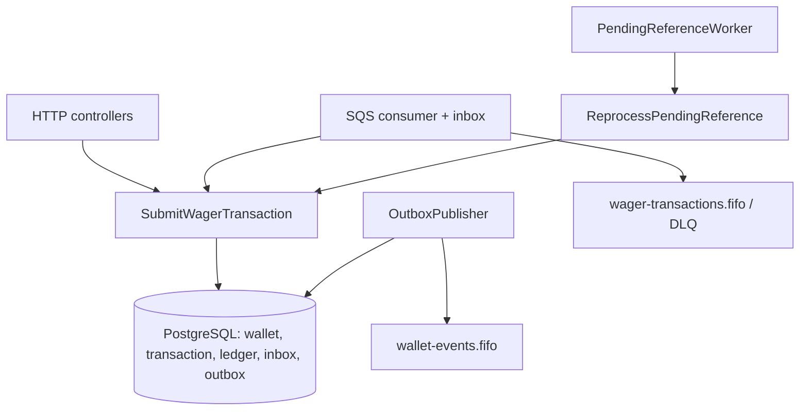

# Wagering Processor — Design

**Spec**: `.specs/features/wagering-processor/spec.md`
**Decisões de projeto**: `.specs/STATE.md` (AD-001 a AD-010) — todas conformadas, nenhuma superada.
**Status**: Draft (aguardando aprovação)

---

## Architecture Overview

Monólito modular hexagonal. **Uma imagem, N réplicas**; cada réplica roda 4 runners, ligáveis por variável de ambiente (`RUN_HTTP`, `RUN_SQS_CONSUMER`, `RUN_OUTBOX_PUBLISHER`, `RUN_PENDING_WORKER`, todos `true` por padrão). Os testes desligam runners seletivamente para simular falha e failover. O único ponto de coordenação entre réplicas é o PostgreSQL.



Regra de dependência: `domain/` (sem Nest, sem ORM) ← `application/` (use cases e portas) ← `infrastructure/` (MikroORM, SQS, HTTP).

```
src/
  domain/          money/ wallet/ wager/ ledger/ messaging/ errors/
  application/     ports/ use-cases/ services/
  infrastructure/  persistence/(schemas, mappers, repositories, unit-of-work, migrations)
                   messaging/(sqs-client, consumer, outbox-publisher, pending-worker)
                   http/(controllers, contracts, filters, auth)
                   observability/ config/
  main.ts
```

### Abordagem escolhida e alternativas descartadas

| Decisão | Escolhida | Descartada | Por quê |
| --- | --- | --- | --- |
| Domínio × persistência | **Record + mapper**: classes de domínio puras; `EntitySchema` sobre records; mappers convertem | `EntitySchema` apontando para a classe de domínio | Mantém `rehydrate` como único caminho de reconstrução e o domínio sem ORM. O spike provou o mapeamento por record (`numeric` → string → `bigint`) |
| Validação de contratos | **Zod**, um schema por contrato, compartilhado por HTTP e SQS | `class-validator` com decorators | Mesmo use case, mesma validação, sem decorators, tipos inferidos |
| Concorrência | **`SELECT … FOR UPDATE` + `version`** (AD-005) | Só otimista; só `SERIALIZABLE` | Lock pessimista serializa a hot wallet sem tempestade de retries |
| Conflito de idempotência no SQS | **DLQ + ack** | Só ack | Preserva a evidência do que não foi gravado |

---

## Code Reuse Analysis

Projeto novo; o reaproveitamento vem do spike (`spike/`, descartável depois) e do compose.

| Componente | Local | Como usar |
| --- | --- | --- |
| Config do ORM (`defineConfig`, `migrationsList`, `snapshot: false`) | `spike/orm.ts` | Copiar para `infrastructure/persistence/orm.config.ts` |
| Mapeamento `numeric` → string | `spike/spike-wallet.record.ts` | Base dos `EntitySchema` reais (`runtimeType: 'string'`, `version: true`) |
| Migration em SQL manual | `spike/migrations.ts` | Padrão de `up()`/`down()` com `addSql` |
| Filas FIFO + redrive | `infra/localstack/init-queues.sh` | Mantido; ganha as filas necessárias aos testes |
| Compose | `docker-compose.yml` | Ganha serviço `migrate`, banco `wagering_test` e imagens com versão fixa |
| Runner de verificação | `spike/run.ts` | Referência para os testes de integração |

### Integration Points

| Sistema | Integração |
| --- | --- |
| PostgreSQL 16 | MikroORM 7 (`@mikro-orm/postgresql`), SQL manual para índices parciais, triggers e CHECKs |
| SQS (LocalStack 4.9) | `@aws-sdk/client-sqs`, endpoint configurável |
| Nest 12 | Controllers, módulos, `ExceptionFilter`, shutdown hooks |

---

## Components

### Money (`domain/money`) — MON-01..09

- **Purpose**: valor monetário imutável e exato.
- **Interfaces**: `Money.from({amount,currency})`, `Money.fromCents(bigint,currency)`, `Money.zero(currency)`, `add/subtract/negate`, `isZero/isPositive/isNegative/isLessThan/equals`, `toJSON()`, `toString()`.
- **Regras**: `bigint` em centavos; `from` aceita `^-?\d+(\.\d{1,2})?$`, normaliza para 2 casas e **nunca arredonda**; a regex estrita `^\d+\.\d{2}$` e `> 0.00` por kind pertencem ao contrato Zod.

### Wallet (`domain/wallet`) — WAL-01..09, CONC

- **Interfaces**: `Wallet.open(props)` → `{ wallet, openingEntry? }`; `rehydrate(state)`; `debit(money, transactionId, at)` e `credit(...)` **retornam o `WalletLedgerEntry`**.
- **Invariante estrutural**: não existe caminho para mudar saldo sem gerar o lançamento. `version` incrementa só na mudança de saldo.

### WagerTransaction (`domain/wager`) — TXN, REV

- **Interfaces**: `create(props)`, `createOpening(props)` (única forma de gerar `OPENING`), `rehydrate`, `markProcessed/markPendingReference/reject/fail`, `scheduleReferenceRetry(now, policy)`, `ledgerDirectionFor(reference)`, `matchesPayload(hash)`.
- **Transições**: `PENDING → PROCESSED | REJECTED | PENDING_REFERENCE | FAILED`; `PENDING_REFERENCE → PROCESSED | REJECTED | FAILED`; terminais lançam `InvalidTransactionStateError`.

### WagerRules (`domain/wager`) — TXN, REV (função pura)

- **Interface**: `decide({ wallet, transaction, reference?, alreadyReversed }): Outcome`.
- **Outcome**: `Processed{ entry? }` | `Rejected{ code }` | `PendingReference`. Contém toda a tabela da seção 7; testável sem banco.

### WalletLedgerEntry, InboxMessage, OutboxMessage, IntegrationEvent (`domain/ledger`, `domain/messaging`)

- Todos `readonly`; `create` do lançamento valida `before ± money == after`.
- `IntegrationEvent<T>` abstrata; subclasses `WagerTransactionProcessed`, `WagerTransactionRejected`, `WalletBalanceChanged`, `WagerTransactionPendingReference` com `eventType` e `version` no tipo.

### UnitOfWork e repositórios (`application/ports`, `infrastructure/persistence`)

- **Porta**: `run<T>(fn: (tx: TxRepositories) => Promise<T>): Promise<T>`.
- **`TxRepositories`**: `wallets.lockById` (`FOR UPDATE`), `wallets.insert/save`, `transactions.findByIdempotencyKey / findByExternalId / findReference / hasProcessedReversal / insert / save`, `ledger.append`, `inbox.tryRecord → recorded | duplicate | conflict`, `outbox.enqueue`.
- **Adaptador**: `em.transactional` do MikroORM, `SET LOCAL lock_timeout = '2s'` na abertura, mappers `toDomain` / `applyToRecord`.

### SubmitWagerTransaction (`application/use-cases`) — TXN, REV, IDEM, CONC, SQS

Mesmo use case para HTTP, SQS e worker. Dentro de uma transação SQL:

1. `lock_timeout` curto.
2. Se veio do SQS, `inbox.tryRecord` (`duplicate` → `Duplicate`; `conflict` → `InboxConflict`).
3. `wallets.lockById`. Inexistente → `WalletNotFound`. **`playerId` ou moeda diferentes da wallet → `WalletPlayerMismatch` / `CurrencyMismatch`**. Os três não gravam transação.
4. **Dedup depois do lock**: mesma key e mesmo hash → `Replay`; hash diferente → `IdempotencyConflict`; mesmo `externalTransactionId` com outra key → `ExternalIdConflict`.
5. Resolve a referência (mesmo provider) e `hasProcessedReversal`; chama `WagerRules.decide`.
6. Persiste transação no estado final, lançamento, wallet (`UPDATE … WHERE version`), eventos na outbox; commit.

**Retry de concorrência** (fora da transação, até 3 vezes, 20/60/180 ms com jitter): SQLSTATE `55P03`, `40001`, `40P01`, `OptimisticLockError` e `23505` nas constraints de idempotência, external id e reversão. A reexecução cai no passo 4 e vira replay ou 409. Esgotado → `ConcurrencyConflict` (503). Conta `lock_conflicts_total`.

O mesmo `idempotencyKey` com `walletId` diferente toma locks em wallets diferentes; o `23505` do `UNIQUE (provider_id, idempotency_key)` resolve, e o retry devolve 409.

**Resposta e replay**: derivados do estado persistido (`status`, `balance_after`, `failure_code`): `PROCESSED` → 201, `PENDING_REFERENCE` → 202, `REJECTED` → 422, `FAILED` → 500. `idempotentReplay` indica que veio do passo 4.

### Outros use cases

`OpenWallet` (wallet, `OPENING`, lançamento e eventos numa transação; `23505` em `(player_id, currency)` → 409), `ReprocessPendingReference`, `PublishOutboxBatch`, `ReconcileWallet`, `GetWallet`, `ListLedger`, `GetTransactionById`, `GetTransactionByExternalId`.

### SqsConsumer (`infrastructure/messaging`) — SQS-01..13

Long-poll de 10 mensagens, processamento paralelo (o FIFO já impede duas mensagens do mesmo `MessageGroupId` em voo). Contrato Zod; falha de validação → DLQ + ack.

| Resultado | Ação |
| --- | --- |
| Processed, Rejected, PendingReference, Replay, Duplicate, WalletNotFound, WalletPlayerMismatch, CurrencyMismatch | ack **depois do commit** (os três últimos com log e métrica) |
| InboxConflict, IdempotencyConflict, ExternalIdConflict | DLQ + ack + métrica |
| Transitório ou desconhecido | sem ack; `ChangeMessageVisibility = min(2^receiveCount · 2s, 60s)`; redrive `maxReceiveCount = 5` → DLQ |

`SIGTERM`: para o polling, aguarda as mensagens em andamento por até 20 s e devolve a visibilidade das demais. Ponto de fault injection (`FAULT_INJECTION=crash-after-commit-before-ack`) só existe sob variável de ambiente de teste.

### OutboxPublisher (`infrastructure/messaging`) — OUT-01..12

Loop de 500 ms. Transação curta: seleciona até 25 linhas pendentes, vencidas e sem lease válida com `FOR UPDATE SKIP LOCKED`, grava `locked_until = now() + 30 s`, commit. **Fora de transação**: `SendMessageBatch` (`MessageGroupId = group_key`, `MessageDeduplicationId = eventId`). Sucesso → `published_at`; falha → `attempts + 1`, backoff `min(2^n s, 60 s)`, libera a lease.

**A ordem entre eventos de uma wallet é best-effort**: falha com backoff e publishers concorrentes podem invertê-los. O consumidor ordena por `walletVersion` e deduplica por `eventId`. Não se promete ordem estrita.

### PendingReferenceWorker (`infrastructure/messaging`) — PREF-01..06

Loop de 1 s: seleciona ids vencidos (sem lock) e, para cada um, `ReprocessPendingReference` numa transação. **Trava a wallet primeiro**, depois relê a transação (`status = 'PENDING_REFERENCE' AND next_attempt_at <= now()`); se não estiver mais elegível, sai. A ordem wallet → transação é a mesma do caminho síncrono, o que evita deadlock. Política: 10 tentativas, base 1 s, fator 2, teto 5 min, configurável por env.

### HTTP (`infrastructure/http`) — API, AUTH

- Controllers finos; contratos Zod; `Idempotency-Key` obrigatório; `providerId = "internal"` rejeitado.
- `ExceptionFilter` + mapper `Outcome → status`: 201/202/400/404/409/422/503 (`Retry-After: 1`)/500. Corpo de erro `{ failureCode, message, details? }`.
- `AuthGuard` no-op chamando `ProviderIdentityPort.assertCanActAs(providerId)`; implementação `AllowAllProviderIdentity`. **Aceita todos os provedores; a aplicação não deve ir para produção assim.**

### Observabilidade (`infrastructure/observability`) — OBS

- Logs JSON (pino) com `AsyncLocalStorage` (`correlationId`, `messageId`, `transactionId`, `walletId`, `providerId`); nunca `amount`, saldos ou `playerId`.
- `prom-client` em `/metrics`. `outbox_pending`, `outbox_lag_seconds` e `outbox_messages_high_attempts` vêm do banco, então **todas as réplicas reportam o mesmo valor: agregar com `max()`, nunca `sum()`**.
- `/health/live` sem I/O; `/health/ready` com `SELECT 1` (o MikroORM 7 conecta sob demanda) e `GetQueueUrl`.

---

## Data Models

Migrations em SQL manual (`up`/`down`), `migrationsList` explícito, `snapshot: false`. Rodam num serviço Compose `migrate` de execução única antes das réplicas. IDs são UUIDv7 (`Bun.randomUUIDv7()`).

### wallets

`id uuid PK`, `player_id uuid`, `currency char(3)`, `balance numeric(20,2) CHECK (balance >= 0)`, `version int CHECK (version >= 1)`, timestamps.
`UNIQUE (player_id, currency)`; `UNIQUE (id, currency, player_id)` e `UNIQUE (id, currency)` como alvos das chaves estrangeiras compostas.

### wager_transactions

Identidade e payload: `id`, `provider_id`, `external_transaction_id`, `idempotency_key`, `payload_hash char(64)`, `wallet_id`, `player_id`, `round_id`, `game_id`, `kind`, `amount numeric(20,2)`, `currency`, `reference_external_transaction_id`, `reference_transaction_id` (FK para si mesma).
Estado: `status`, `failure_code`, `balance_after`, `reference_attempts`, `next_attempt_at`, `created_at`, `processed_at`, `updated_at`.

| Garantia | Constraint |
| --- | --- |
| Idempotência por provedor | `UNIQUE (provider_id, idempotency_key)` |
| Id externo único por provedor | `UNIQUE (provider_id, external_transaction_id)` |
| Reversão única | `UNIQUE (reference_transaction_id) WHERE kind IN ('REFUND','ROLLBACK') AND status = 'PROCESSED'` |
| Player e moeda coerentes com a wallet | `FOREIGN KEY (wallet_id, currency, player_id) → wallets (id, currency, player_id)` |
| Referência obrigatória | `CHECK (kind NOT IN ('REFUND','ROLLBACK') OR reference_external_transaction_id IS NOT NULL)` |
| Valor positivo (exceto LOSS) | `CHECK (kind = 'LOSS' OR amount > 0)` |
| `failure_code` coerente com o status | `CHECK ((status IN ('REJECTED','FAILED')) = (failure_code IS NOT NULL))` |
| Valores válidos | `CHECK` de `kind` e `status` |
| Estados terminais imutáveis | trigger: `UPDATE` de linha em `PROCESSED`, `REJECTED` ou `FAILED` falha |
| Varredura do worker | índice parcial `(next_attempt_at) WHERE status = 'PENDING_REFERENCE'` |

`OPENING` usa `provider_id = 'internal'` e `external_transaction_id = idempotency_key = 'opening:{walletId}'`. O valor `internal` é reservado e rejeitado no contrato.

### wallet_ledger_entries

`id`, `wallet_id`, `currency`, `transaction_id` (`UNIQUE`, FK), `direction`, `amount`, `balance_before`, `balance_after`, `wallet_version`, `created_at`.
`UNIQUE (wallet_id, wallet_version)`; `FOREIGN KEY (wallet_id, currency) → wallets (id, currency)`; `CHECK (amount > 0)`; `CHECK (balance_before >= 0 AND balance_after >= 0)`; `CHECK (balance_after = balance_before + CASE direction WHEN 'CREDIT' THEN amount ELSE -amount END)`; triggers que bloqueiam `UPDATE`, `DELETE` e `TRUNCATE`.

### inbox_messages

`PRIMARY KEY (consumer_name, message_id)`, `payload_hash`, `received_at`, `processed_at`.

### outbox_messages

`id` (= `eventId`), `aggregate_id`, `group_key` (= `walletId`), `event_type`, `payload jsonb`, `occurred_at`, `attempts`, `next_attempt_at`, `locked_until`, `published_at`, `last_error`. Índice parcial `WHERE published_at IS NULL`.

---

## Error Handling Strategy

| Cenário | Tratamento | Impacto para o provedor |
| --- | --- | --- |
| Payload ou header inválido, `providerId = "internal"` | Zod → 400 `VALIDATION_ERROR` / `IDEMPOTENCY_KEY_REQUIRED` | Corrigir e reenviar |
| `walletId` inexistente; `playerId` ou moeda diferentes da wallet | 422 `WALLET_NOT_FOUND` / `WALLET_PLAYER_MISMATCH` / `CURRENCY_MISMATCH`, **sem persistir** | Corrigir e enviar como nova operação |
| Key reutilizada com payload diferente; mesmo id externo com outra key | 409 `IDEMPOTENCY_KEY_REUSED` / `EXTERNAL_ID_CONFLICT` | Não reenviar igual |
| Regra de negócio violada | 422 com `failureCode`, transação `REJECTED` persistida | Desistir ou corrigir |
| Referência ausente | 202, `PENDING_REFERENCE`, worker reprocessa | Aguardar evento |
| `lock_timeout`, deadlock, conflito de versão | Retry limitado; esgotado → 503 `CONCURRENCY_CONFLICT` + `Retry-After` | Reenviar igual |
| PostgreSQL ou SQS indisponível | 503 `DEPENDENCY_UNAVAILABLE`; a outbox acumula se o SQS cair | Reenviar igual |
| Erro inesperado | 500 `INTERNAL_ERROR` | Reenviar igual (idempotente) |
| SQS: malformada ou conflito de idempotência | DLQ + ack | Investigar pela DLQ |
| SQS: erro transitório | Sem ack, visibilidade com backoff, DLQ após 5 recebimentos | — |

---

## Test Strategy

`bun test`, PostgreSQL e LocalStack reais via Compose. **Integração e concorrência rodam no banco `wagering_test`**, separado do de desenvolvimento (criado por script de init do Postgres).

| Suíte | Cobre |
| --- | --- |
| `test/unit` | `Money`, `Wallet`, `WagerTransaction`, `WagerRules` (tabela completa por kind), hash do payload, `IntegrationEvent` |
| `test/integration` | migrations up→down→up; uma violação por constraint e trigger via SQL (incluindo as FKs compostas); atomicidade (falha injetada após o ledger não persiste nada); inbox e redelivery; 2 publishers na mesma outbox; retry e DLQ; reinício |
| `test/concurrency` | 50× a mesma aposta; 100 / 2×80; wallets em paralelo; **3 processos** via `Bun.spawn`; crash após o commit e antes do ack; REFUND/ROLLBACK antes da referência; reinício com consistência final |

Isolamento: cada teste cria wallets e ids próprios, sem `TRUNCATE` (o trigger o bloqueia). Todo teste de integração e concorrência termina com `assertReconciled(walletIds)`.
Scripts: `test:unit`, `test:integration`, `test:concurrency` e `test` (os três em sequência).

---

## Risks & Concerns

| Concern | Location | Impact | Mitigation |
| --- | --- | --- | --- |
| `SET LOCAL lock_timeout` pode não valer na conexão da transação do MikroORM 7 | `infrastructure/persistence/unit-of-work` | `lock_timeout` ignorado: espera ilimitada na hot wallet | Primeira task de persistência prova com teste que o timeout vale dentro de `em.transactional` |
| `numeric` hidratado como `number` em algum caminho | mappers | Perda de precisão monetária (falha eliminatória) | `runtimeType: 'string'` + teste de tipo no mapper + grep de `number` em campos de valor |
| Grupo FIFO bloqueado por mensagem em retry | `SqsConsumer` | Atraso das mensagens da mesma wallet | Backoff com teto de 60 s, DLQ após 5 recebimentos, malformadas e conflitos direto para a DLQ |
| Flakiness nos testes de concorrência | `test/concurrency` | Teste intermitente reprova a avaliação | Asserções só sobre estado final + reconciliação; cenário 100 / 2×80 repetido 20 vezes |
| Pool de conexões esgotado com 50 requisições paralelas | `orm.config` | Timeouts espúrios | `pool.max` configurável (20) e `lock_timeout` curto |
| Imagens `:latest` mudam o comportamento entre máquinas | `docker-compose.yml` | Teste do avaliador falha por versão diferente | **Versões fixas** de PostgreSQL e LocalStack no Compose, nunca `:latest` (ajuste pendente na task de setup) |
| Ordem de eventos invertida na outbox | `OutboxPublisher` | Consumidor aplica evento antigo depois do novo | Ordem documentada como best-effort; consumidor ordena por `walletVersion` e deduplica por `eventId` |
| Métrica de outbox somada entre réplicas | `/metrics` | Valor multiplicado pelo número de réplicas | Documentado: agregar com `max()`, nunca `sum()` |
| `AuthGuard` aceita qualquer provedor | `infrastructure/http/auth` | API aberta em produção | Registrado no ARCHITECTURE.md: a aplicação não deve ir para produção assim; desenho Keycloak documentado |
| Deadlock entre worker de pendências e caminho síncrono | `PendingReferenceWorker` | Transação abortada | Ordem de lock fixa: wallet primeiro, transação depois, nos dois caminhos |

---

## Tech Decisions (só as não óbvias)

| Decisão | Escolha | Racional |
| --- | --- | --- |
| Dedup depois do lock da wallet | Passo 4 do use case | O lock serializa as requisições da mesma wallet; a constraint única pega o caso de wallets diferentes |
| Rejeição sem persistir para wallet, player e moeda | 422 sem gravar | A FK composta torna a gravação impossível; o schema é a garantia |
| `Wallet.debit/credit` retornam o lançamento | Retorno obrigatório | Impossível alterar saldo sem ledger |
| Transação nasce em `PENDING` só em memória | Persistida direto no estado final | Evita commits intermediários que exigiriam recuperação própria |
| Outbox: lease em vez de transação longa | `locked_until` | Nenhuma transação aberta durante a rede; crash é recuperado quando a lease expira |
| Migrations em serviço único | `migrate` one-shot no Compose | Evita três réplicas migrando ao mesmo tempo |
| UUIDv7 | `Bun.randomUUIDv7()` | Ordenável, bom para índices e paginação |

> Decisões de projeto registradas em `.specs/STATE.md`: AD-007 (record + mapper), AD-008 (Zod compartilhado), AD-009 (migrations em SQL manual + serviço `migrate`), AD-010 (FK composta wallet/moeda/player).
